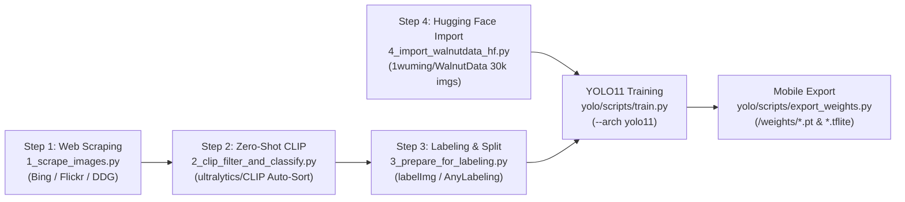

# WalnutIQ Dataset Builder & `.pt` Preparation Pipeline (`yolo/dataset_builder/`)

Because public datasets only cover part of the walnut lifecycle — specifically **`1wuming/WalnutData` (`nanmao/WalnutData` on Hugging Face)** which provides **30,240 canopy images of green walnuts** (`A1: front-lit unoccluded`, `A2: backlit unoccluded`, `B1: front-lit occluded`, `B2: backlit occluded`) — we built this dedicated **`yolo/dataset_builder/`** pipeline to create, filter, label, and merge the complete dataset for **YOLO11**:

1. **Mode 1 — In-Tree Canopy Counter (`walnut_canopy.pt` via `yolo11s.pt`)**:
   - `0: walnut_green` (from `1wuming/WalnutData` + custom photos)
   - `1: walnut_hull_split` (scraped + CLIP-filtered + labeled)
   - `2: walnut_blight_damaged` (scraped + CLIP-filtered + labeled)
2. **Mode 2 — Ground Harvest Picker (`walnut_ground.pt` via `yolo11n.pt`)**:
   - `0: walnut_in_shell` (fallen brown walnuts on soil, grass, and autumn leaves)
   - `1: walnut_in_hull` (fallen walnuts still inside green/black husks on the ground)
3. **Optional Mode 3 — Crop & Disease Classifier (`walnut_classify.pt` via `yolo11n-cls.pt`)**:
   - Zero-effort folder-based classification trained directly from the CLIP-sorted folders before or alongside bounding-box labeling.

---

## End-to-End 4-Step Workflow



---

### Step 1: Scrape Missing Ground & Hull-Split Walnut Images
Uses the patterns from **[ultralytics/google-images-download](https://github.com/ultralytics/google-images-download)** (Bing HTML/Selenium), **[ultralytics/flickr_scraper](https://github.com/ultralytics/flickr_scraper)** (Flickr API pagination), and DuckDuckGo with SHA-256 deduplication:

```bash
python yolo/dataset_builder/1_scrape_images.py --target all --max-per-query 60
```
*Output*: Saves verified unique images (`>= 300x300px`) into `yolo/dataset_builder/raw_scraped/`.

---

### Step 2: Auto-Filter Junk & Sort Classes with Ultralytics CLIP
Uses **[ultralytics/CLIP](https://github.com/ultralytics/CLIP)** (`ViT-B/32`) to automatically remove non-orchard images (wooden furniture, walnut cakes, retail bags) and sort real walnut photos into `yolo/dataset_builder/curated/{canopy,ground}/<class_name>/`:

```bash
# Install Ultralytics CLIP once if not yet installed:
python -m pip install ftfy regex git+https://github.com/ultralytics/CLIP.git

# Run zero-shot CLIP sorting (+ optional YOLO11-cls dataset export):
python yolo/dataset_builder/2_clip_filter_and_classify.py --export-yolo-cls
```

---

### Step 3: Bounding-Box Labeling (`labelImg` / `AnyLabeling`) & Split
Generates the exact `classes.txt` files for your labeling tool and then splits your labeled `.txt` boxes (`80% train / 15% val / 5% test`) into `yolo/datasets/`:

```bash
# 1. Create classes.txt in curated/canopy and curated/ground
python yolo/dataset_builder/3_prepare_for_labeling.py --setup-classes

# 2. Open your labeling tool (e.g. labelImg) in YOLO format:
labelImg yolo/dataset_builder/curated/ground/walnut_in_shell yolo/dataset_builder/curated/ground/classes.txt

# 3. Copy finished image + .txt pairs into yolo/datasets/walnut_{canopy,ground}:
python yolo/dataset_builder/3_prepare_for_labeling.py --finalize-splits
```

---

### Step 4: Import `1wuming/WalnutData` (Hugging Face `nanmao/WalnutData`)
Once you download `WalnutData` from Hugging Face (or let the script download it directly), import and remap its 4 canopy lighting/occlusion classes (`A1, A2, B1, B2`) into `yolo/datasets/walnut_canopy`:

```bash
# Option A: Point to your downloaded folder
python yolo/dataset_builder/4_import_walnutdata_hf.py --source C:/Path/To/WalnutData --max-samples 5000

# Option B: Download directly from Hugging Face Hub
python yolo/dataset_builder/4_import_walnutdata_hf.py --download-hf --max-samples 5000
```

---

### Step 5: Train YOLO11 & Export `.pt` / `.tflite` to `/weights`

```bash
# Train Canopy Counter (defaults to yolo11s.pt)
python yolo/scripts/train.py --mode canopy --arch yolo11 --epochs 100

# Train Ground Picker (defaults to yolo11n.pt)
python yolo/scripts/train.py --mode ground --arch yolo11 --epochs 100

# Export trained .pt to /weights/canopy/ and /weights/ground/ + update manifest.json
python yolo/scripts/export_weights.py --mode canopy --weights yolo/runs/walnut_canopy_yolo11/weights/best.pt
python yolo/scripts/export_weights.py --mode ground --weights yolo/runs/walnut_ground_yolo11/weights/best.pt
```

