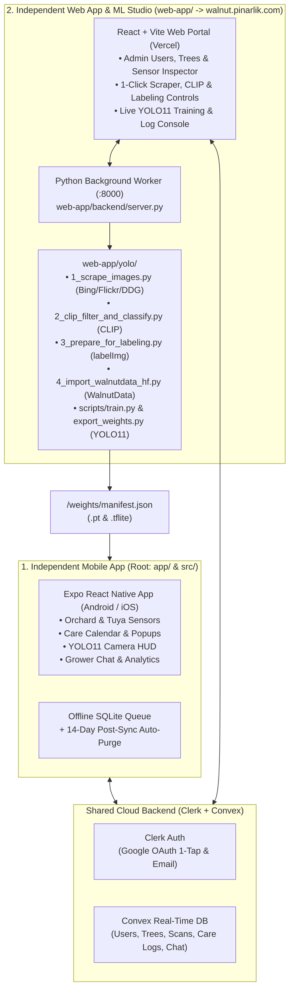

# WalnutIQ: Tree Care & AI Count — Internal Technical Architecture Overview

> **Note**: This document is for internal engineering reference. For step-by-step commands on how to run each service, see **[00_Running_processes.md](./00_Running_processes.md)**.

---

## 1. System Architecture (Independent Mobile App + Independent Web App on `walnut.pinarlik.com`)

To ensure a clean separation between the **Google Play Mobile App** and the **Vercel Web App (`https://walnut.pinarlik.com`)** + **Background ML Pipeline**, the project is organized so that:
1. **Mobile App (Root: `app/` & `src/`)** is strictly for the **React Native + Expo** mobile application. It has zero web-scraper, CLIP, or Python training code inside it. It only loads compiled mobile weights from `/weights` and syncs data with **Clerk** and **Convex**.
2. **Independent Web App & Background ML Studio (`web-app/`)** is a standalone web application deployed to **Vercel (`walnut.pinarlik.com`)** that shares the **exact same Clerk & Convex database** while housing all **YOLO11 training (`web-app/yolo/`), Web Image Scraping, Zero-Shot CLIP Filtering, Labeling, and the Python FastAPI Background Engine (`web-app/backend/server.py`)**.

---

## 2. Repository Directory Map

| Directory / File | Purpose |
| :--- | :--- |
| **`app/` & `src/` (Root)** | **Mobile App Only (React Native + Expo)**: `app/(tabs)/` (`index.tsx`, `calendar.tsx`, `scanner.tsx`, `community.tsx`, `analytics.tsx`) and `app/auth.tsx` (Clerk Mobile Sign-In). |
| **`web-app/`** | **Independent Web App & Background ML Studio (`walnut.pinarlik.com`)**: Standalone Vite + React + TypeScript web app (`web-app/package.json`, `web-app/vercel.json`) with `web-app/backend/server.py` and `web-app/yolo/`. |
| **`web-app/yolo/`** | All **YOLO11** training scripts (`train.py`, `export_weights.py`), dataset configs (`configs/`), requirements (`requirements.txt`), and the 4-stage dataset builder (`dataset_builder/`). |
| **`weights/`** | Staging directory (`weights/canopy/`, `weights/ground/`, `weights/manifest.json`) where `web-app/yolo/scripts/export_weights.py` writes compiled `.pt` and `.tflite` weights for the mobile app. |
| **`convex/`** | Shared Convex real-time database schema (`convex/schema.ts`), Clerk JWT config (`convex/auth.config.ts`), and offline batch sync contracts (`convex/sync.ts`). |
| **`research/`** | Academic paper synthesis & benchmarks (`arXiv:2502.20092v3` & `arXiv:2602.14140`). |
| **`docs/`** | Engineering blueprints, `00_Running_processes.md` beginner guide, UI/UX design system, and Google Play Store listing copy. |

