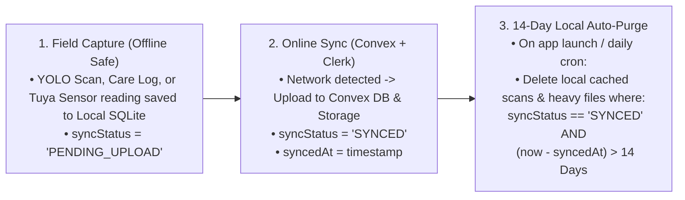

# Phase 4: Hybrid Local-First + Convex & Clerk Sync (With 14-Day Auto-Purge)

> **Status**: Active Blueprint  
> **Goal**: Ensure 100% offline reliability in walnut orchards with zero cell reception, automatic background sync to **Convex** & **Clerk** (Google & Email auth) once online, **automatic 14-day local data purge after sync**, and real-time Grower Community Chat + Web App compatibility.

---

## 1. Locked-In Hybrid Data Lifecycle & 14-Day Auto-Purge

When growers are out in the walnut grove, cellular coverage is often weak or nonexistent. At the same time, storing hundreds of high-resolution camera scans locally forever would bloat the user's phone storage.

We solve both with a **3-Stage Sync & 14-Day Local Retention Pipeline**:

### Key Safeguards of the 14-Day Purge Rule:
1. **Never Purges Unsynced Data**: If a record has `syncStatus === 'PENDING_UPLOAD'` (e.g., the grower hasn't connected to Wi-Fi yet), it is **never** deleted locally, even if older than 14 days.
2. **Purges Only Synced Heavy Cache After 14 Days**: Once Convex confirms receipt (`syncStatus === 'SYNCED'`) and `14 days` (`1,209,600,000 ms`) have elapsed since `syncedAt`, the local SQLite row and local photo file are automatically purged to free up device storage.
3. **Cloud & Web App Permanence**: All historical data remains permanently accessible in **Convex** and can be viewed anytime on the mobile app (when online) or on the companion **Web App**.

---

## 2. Authentication: Clerk (Google Sign-In + Email/Password)

- **1-Tap Google OAuth**: Fast sign-in on Android devices matched to the user's Google Play account.
- **Email + Password / OTP Verification**: Full support for growers who prefer standard email login.
- **Shared Identity Across Mobile & Web**: The exact same Clerk `userId` authenticates against Convex on both the Expo mobile app and the future Next.js Web App.

---

## 3. Real-Time Grower Community Chat & Shareable Cards

Powered by Convex reactive queries:
- **Channels**: `#general-growers`, `#yolo-yield-estimates`, `#pruning-and-training`, `#watering-and-feeding`, `#pest-and-blight-sos`.
- **Direct Messages**: 1-on-1 grower messaging.
- **Embedded Orchard Data Cards**: Share a tree's YOLO canopy count, nut diameter (`mm`), Tuya sensor snapshot, and feeding schedule directly into any chat thread.
